# Dokumentasi Sistem Informasi Desa Cantik

Dokumen ini menjelaskan sistem yang dihasilkan dalam skripsi *Pengembangan Sistem Informasi Desa Cinta Statistik (Desa Cantik) Berbasis Web pada Desa Cinnong, Kabupaten Bone, Provinsi Sulawesi Selatan*. Uraian lengkap tentang latar belakang, analisis, dan evaluasi ada pada buku skripsi, sedangkan langkah penggunaan untuk setiap peran ada pada *Buku Panduan Web Desa Cantik*. Dokumen ini berfokus pada hal yang diperlukan untuk memahami, menjalankan, dan mengembangkan kode.

## Daftar Isi

1. [Gambaran Umum](#1-gambaran-umum)
2. [Peran dan Hak Akses](#2-peran-dan-hak-akses)
3. [Arsitektur dan Teknologi](#3-arsitektur-dan-teknologi)
4. [Struktur Kode](#4-struktur-kode)
5. [Basis Data](#5-basis-data)
6. [Alur Layanan, Pengelolaan Data, dan Replikasi](#6-alur-layanan-pengelolaan-data-dan-replikasi)
7. [Daftar Rute](#7-daftar-rute)
8. [Keamanan](#8-keamanan)
9. [Pengujian](#9-pengujian)
10. [Instalasi dan Penerapan](#10-instalasi-dan-penerapan)
11. [Tampilan Antarmuka](#11-tampilan-antarmuka)

---

## 1. Gambaran Umum

Sistem Informasi Desa Cantik adalah situs web desa untuk program Desa Cinta Statistik (Desa Cantik) yang dibina BPS Kabupaten Bone, dengan Desa Cinnong sebagai desa pertama. Sebelum pengembangan, situs web desa bersifat statis. Setiap perubahan konten dan data statistik harus dikerjakan pengembang di kode sumber, replikasi ke desa lain berarti menyalin dan mengubah kode secara manual, dan pengajuan layanan desa masih dilakukan dengan datang langsung ke kantor desa.

Penelitian ini mengembangkan sistem dalam tiga komponen.

| Komponen | Hasil pengembangan |
|---|---|
| Konten dan data desa yang dinamis | Aparatur desa mengelola profil desa, berita, infografis, dan publikasi sendiri, serta menyusun tabel data statistik dengan struktur kolom bebas (termasuk kolom bertingkat), total baris dan kolom, dan grafik. Pengunjung dapat mengunduh tabel dalam format CSV atau JSON |
| Layanan desa berbasis akun | Warga mendaftar dan memverifikasi surel, lalu mengajukan 12 jenis layanan (surat kependudukan, surat umum, serta pengaduan dan aspirasi) secara daring. Aparatur desa memproses pengajuan, mengunggah dokumen hasil, dan warga menerima notifikasi serta dapat memberi penilaian |
| Replikasi ke desa baru | Identitas desa disimpan di basis data, bukan di kode, sehingga Admin BPS cukup memasang salinan kode yang sama dengan basis data baru lalu mengisi identitas desa melalui antarmuka. Sistem telah direplikasi ke Desa Galung dan Desa Tea Malala |

Istilah yang dipakai di seluruh dokumentasi:

| Istilah | Arti |
|---|---|
| **Tabel dinamis** | Tabel data statistik yang struktur kolomnya disusun admin melalui antarmuka. Struktur disimpan sebagai JSON di `dynamic_tables.columns`, dan setiap baris isian disimpan sebagai JSON di `dynamic_table_data.data` |
| **Kolom grup** | Kolom bertipe `group` yang memiliki `subColumns`, dipakai untuk membuat kepala tabel bertingkat |
| **Jenis layanan** | Satu jenis surat atau pengaduan pada tabel `layanan_settings`. Admin BPS dapat mengaktifkan atau menonaktifkannya |
| **Pengajuan** | Satu permohonan layanan dari pengguna terdaftar pada tabel `layanan_submissions`, beserta isian formulir, berkas lampiran, status, catatan admin, dokumen hasil, dan penilaian |
| **Pengaturan desa** | Pasangan kunci-nilai pada tabel `settings` yang menyimpan identitas dan profil desa, misalnya `nama_desa`, `kecamatan`, `visi`, dan `misi` |
| **Instans** | Satu salinan sistem yang berjalan untuk satu desa, dengan domain dan basis data sendiri |

## 2. Peran dan Hak Akses

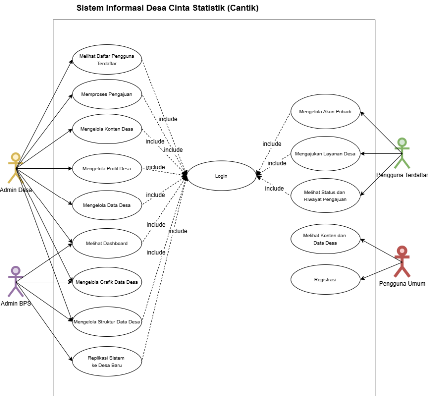

| Peran | Pihak | Hak akses utama |
|---|---|---|
| **Pengguna Umum** | Pengunjung tanpa akun | Melihat beranda, profil desa, data desa beserta grafik, berita, infografis, dan publikasi, serta mengunduh tabel data dan berkas publikasi |
| **Pengguna Terdaftar** (`pengguna_terdaftar`) | Warga desa yang mendaftar | Seluruh hak Pengguna Umum, ditambah mengajukan layanan desa, melihat status dan riwayat pengajuan, mengunduh dokumen hasil, memberi penilaian, menerima notifikasi, dan mengelola profil akun |
| **Admin Desa** (`admin_desa`) | Aparatur Desa | Melihat dasbor, mengelola berita, infografis, dan publikasi, memproses pengajuan layanan, mengelola profil desa (kecuali identitas dan lokasi), mengelola tabel data dan grafik, serta melihat daftar pengguna terdaftar |
| **Admin BPS** (`admin_bps`) | Pegawai BPS Kabupaten Bone | Melihat dasbor, mengaktifkan atau menonaktifkan jenis layanan, membuat dan mengelola akun Admin Desa, mengelola seluruh profil desa termasuk identitas dan lokasi, serta mengelola tabel data dan grafik |

Peran disimpan pada kolom `users.role` dengan nilai awal `pengguna_terdaftar`, sehingga setiap akun yang mendaftar sendiri otomatis menjadi Pengguna Terdaftar. Akun admin hanya dibuat melalui *seeder* atau oleh Admin BPS.

Aturan yang ditegakkan server:

- Middleware `admin.only` (`app/Http/Middleware/AdminOnly.php`) melindungi seluruh rute `/admin/*` dan hanya meloloskan `admin_bps` dan `admin_desa`.
- Middleware `pengguna.terdaftar` (`app/Http/Middleware/PenggunaTerdaftar.php`) melindungi rute `/layanan/*` dan penilaian. Middleware ini mensyaratkan peran `pengguna_terdaftar` dan surel yang sudah diverifikasi.
- `Admin/UserController.php`: Admin BPS hanya dapat membuat, mengubah, dan menghapus akun berperan `admin_desa`, dan peran pada formulir dikunci ke `admin_desa`. Admin Desa hanya dapat melihat daftar akun `pengguna_terdaftar`.
- `Admin/ProfilDesaController.php`: kunci `nama_desa`, `kecamatan`, `kabupaten`, dan `provinsi` hanya divalidasi dan disimpan bila pengirim adalah Admin BPS. Kunci yang sama dari Admin Desa diabaikan.
- `PenggunaTerdaftarController@submitRating`: penilaian hanya diterima dari pemilik pengajuan, hanya untuk pengajuan berstatus `selesai`, dan hanya satu kali.

Pembagian menu per peran diatur di `resources/js/layouts/AuthenticatedLayout.tsx`. Menu Kelola Berita, Kelola Infografis, Kelola Publikasi, dan Kelola Layanan hanya ditampilkan untuk Admin Desa, sedangkan menu Pengaturan Layanan hanya ditampilkan untuk Admin BPS. Pemisahan menu ini hanya di sisi tampilan (lihat Bagian 8).

## 3. Arsitektur dan Teknologi

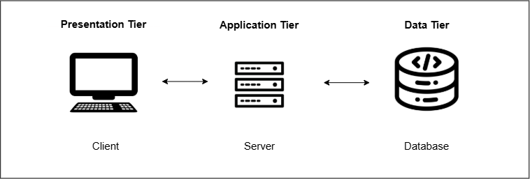

Sistem memakai arsitektur *three-tier* dalam satu aplikasi Laravel. Inertia.js menghubungkan *controller* Laravel dengan halaman React, sehingga tidak ada REST API terpisah. *Controller* mengembalikan `Inertia::render('NamaHalaman', $props)`, dan data dikirim langsung sebagai *props* ke komponen React.

| Lapisan | Teknologi |
|---|---|
| *Presentation tier* (`resources/js/`) | React 19, TypeScript, Tailwind CSS 4, Vite 7, Inertia.js v2 (`@inertiajs/react`), Radix UI, Headless UI, `lucide-react`, Chart.js dan `react-chartjs-2` untuk grafik, Ziggy untuk memanggil nama rute Laravel dari React |
| *Application tier* (`app/`, `routes/`) | Laravel 12 di atas PHP 8.2 atau lebih baru, `inertiajs/inertia-laravel`, autentikasi bawaan Laravel (pola Breeze) dengan verifikasi surel |
| *Data tier* | MySQL atau MariaDB |
| Notifikasi | Laravel Notifications melalui kanal `database` dan `mail` (SMTP). Paket `resend/resend-laravel` juga terpasang sebagai alternatif pengirim surel |
| Penyimpanan berkas | Folder `public/images/` dan `public/dokumen/` di server |
| Penerapan | Hosting dengan domain per desa, misalnya `cinnong.bone.stat7300.net` dan `galung.bone.stat7300.net` |

Paket `revolution/laravel-google-sheets` dan berkas `config/google.php` masih terpasang dari tahap awal pengembangan, tetapi tidak dipakai oleh kode yang berjalan saat ini.

## 4. Struktur Kode

### 4.1 Backend

| Folder atau berkas | Tanggung jawab |
|---|---|
| `routes/web.php` | Rute publik (beranda, profil, data desa, berita, infografis, publikasi), rute layanan untuk pengguna terdaftar, dan profil akun. Berkas ini juga memuat `auth.php`, `settings.php`, dan `dashboard.php` |
| `routes/dashboard.php` | Seluruh rute panel admin dengan awalan `/admin` dan nama `admin.*` |
| `routes/auth.php` | Registrasi, masuk, lupa dan atur ulang kata sandi, verifikasi surel, konfirmasi kata sandi, keluar, dan notifikasi |
| `routes/settings.php` | Pengaturan akun (profil, kata sandi, tampilan) |
| `app/Http/Controllers/` (akar) | Halaman publik: `PageController` (beranda), `DataDesaController` (tabel dan unduhan), `BeritaController`, `InfografisController`, `PublikasiController`, serta `LayananController` (12 formulir layanan dan penyimpanan pengajuan), `PenggunaTerdaftarController` (profil, riwayat, penilaian), dan `NotificationController` |
| `app/Http/Controllers/Admin/` | Panel admin: `DashboardController`, `BeritaController`, `InfografisController`, `PublikasiController`, `LayananController` (memproses pengajuan), `LayananSettingsController` (mengaktifkan jenis layanan), `ProfilDesaController`, `DynamicTableController` (struktur tabel, isian data, grafik), dan `UserController` |
| `app/Http/Controllers/Auth/`, `Settings/` | Autentikasi dan pengaturan akun bawaan *starter kit* Laravel |
| `app/Http/Middleware/` | `AdminOnly`, `PenggunaTerdaftar`, `HandleInertiaRequests` (data bersama untuk semua halaman, misalnya pengguna yang masuk dan pengaturan desa), dan `HandleAppearance` |
| `app/Models/` | `User`, `UserProfile`, `Berita`, `Infografis`, `Publikasi`, `Setting`, `VillageOfficial`, `DynamicTable`, `DynamicTableData`, `LayananSetting`, dan `LayananSubmission` |
| `app/Notifications/StatusLayananNotification.php` | Notifikasi perubahan status pengajuan ke basis data dan surel |
| `database/migrations/` | Skema basis data (Bagian 5) |
| `database/seeders/` | Akun awal Admin BPS dan Admin Desa serta contoh berita, infografis, dan publikasi |
| `bootstrap/app.php` | Pendaftaran alias middleware `admin.only` dan `pengguna.terdaftar` |

### 4.2 Frontend (`resources/js/`)

| Folder | Isi |
|---|---|
| `pages/` | Halaman publik: `Beranda`, `ProfilDesa`, `DataDesa`, `Berita`, `DetailBerita`, `InfografisDesa`, `DetailInfografis`, dan `Publikasi` |
| `pages/Admin/` | Satu folder per menu admin, yaitu `Berita`, `Infografis`, `Publikasi`, `Layanan`, `LayananSettings`, `Profil`, `DynamicTables`, dan `Users`, ditambah `Dashboard.tsx` |
| `pages/Layanan/FormLayanan.tsx` | Satu komponen formulir untuk seluruh jenis layanan. Daftar isian setiap layanan dikirim dari `LayananController` |
| `pages/Pengguna/Profil.tsx` | Profil pengguna terdaftar beserta riwayat pengajuan dan penilaian |
| `pages/auth/`, `pages/settings/` | Halaman masuk, registrasi, verifikasi surel, atur ulang kata sandi, dan pengaturan akun |
| `layouts/` | Tata letak halaman publik, panel admin (`AuthenticatedLayout.tsx`), autentikasi, dan pengaturan |
| `components/`, `hooks/`, `lib/`, `types/` | Komponen UI bersama, *hook*, utilitas, dan definisi tipe TypeScript |

## 5. Basis Data

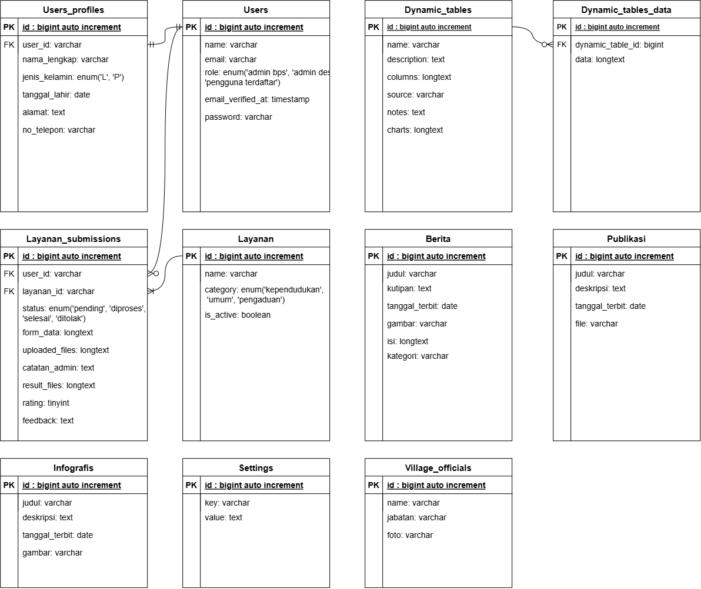

Skema ditulis sebagai migrasi Laravel di `database/migrations/`. Salinan basis data lengkap beserta isinya juga tersedia di `desa_db.sql` pada akar repositori. Migrasi membuat 19 tabel.

| Kelompok | Tabel |
|---|---|
| Pengguna dan akses | `users`, `user_profiles`, `password_reset_tokens`, `sessions` |
| Profil desa | `settings`, `village_officials` |
| Konten desa | `berita`, `infografis`, `publikasi` |
| Data statistik | `dynamic_tables`, `dynamic_table_data` |
| Layanan desa | `layanan_settings`, `layanan_submissions` |
| Notifikasi | `notifications` |
| Bawaan Laravel | `cache`, `cache_locks`, `jobs`, `job_batches`, `failed_jobs` |

Catatan kolom penting:

- `users.role`: `admin_bps`, `admin_desa`, atau `pengguna_terdaftar` (nilai awal). Data diri warga (nama lengkap, jenis kelamin, tanggal lahir, alamat, nomor telepon, pekerjaan) disimpan terpisah di `user_profiles`.
- `dynamic_tables`: `name`, `columns` (JSON), `has_column_total`, `has_row_total`, `has_row_number`, `charts` (JSON berisi daftar grafik), `source`, dan `notes`.
- `layanan_settings`: `name`, `category` (`kependudukan`, `umum`, atau `pengaduan`), dan `is_active`. Isi awalnya dibuat oleh migrasi `seed_layanan_settings`.
- `layanan_submissions`: `user_id`, `layanan_id`, `form_data` (JSON), `uploaded_files` (JSON), `status`, `catatan_admin`, `result_files` (JSON), `rating`, `feedback`, dan `rated_at`.
- `settings`: kunci yang dipakai adalah `nama_desa`, `kecamatan`, `kabupaten`, `provinsi`, `jumlah_rt`, `luas`, `email`, `telepon`, `sejarah`, `visi`, `misi`, `stat1_label` sampai `stat3_value` (tiga statistik ringkas di halaman profil), `data_terakhir`, `gambar_peta`, dan `gambar_tim`.

## 6. Alur Layanan, Pengelolaan Data, dan Replikasi

### 6.1 Pengajuan layanan desa

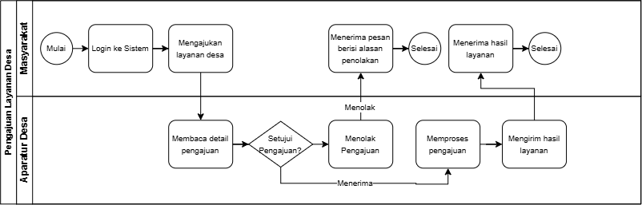

1. Warga mendaftar, lalu membuka tautan verifikasi yang dikirim ke surelnya. Selama surel belum terverifikasi, menu layanan tidak dapat dibuka.
2. Warga memilih jenis layanan. Hanya jenis layanan dengan `is_active = true` yang dapat diajukan. Nama dan surel pemohon diambil otomatis dari akun yang sedang masuk.
3. Saat formulir dikirim ke `POST /layanan/submit`, setiap lampiran divalidasi (JPG, PNG, GIF, PDF, DOC, atau DOCX, paling besar 5 MB) dan disimpan di `public/dokumen/pengajuan_layanan/`. Pengajuan tersimpan dengan status `pending`.
4. Admin Desa membuka **Kelola Layanan**, menyaring pengajuan menurut status atau jenis, lalu melihat detailnya.
5. Admin Desa mengubah status. Penolakan wajib disertai catatan. Status `selesai` dapat disertai dokumen hasil (paling besar 1 MB per berkas) yang disimpan di `public/dokumen/hasil_pengajuan/`.
6. Setiap perubahan status selain `pending` mengirim `StatusLayananNotification` ke pemohon melalui notifikasi di situs dan surel.
7. Pemohon melihat status dan mengunduh dokumen hasil di halaman profilnya, lalu dapat memberi penilaian 1–5 bintang beserta masukan.

Status pengajuan: `pending` (Menunggu), `diproses`, `selesai`, `ditolak`.

Jenis layanan bawaan:

| Kategori | Layanan |
|---|---|
| Kependudukan | Surat Pengantar KTP, Surat Pengantar KK, Surat Keterangan Domisili, Surat Keterangan Usaha, Surat Keterangan Tidak Mampu (SKTM), Surat Keterangan Kelahiran, Surat Keterangan Kematian |
| Umum | Surat Pengantar Nikah, Surat Keterangan Pindah, Surat Izin Kegiatan, Surat Rekomendasi Desa |
| Pengaduan | Pengaduan & Aspirasi Masyarakat |

Untuk menambah jenis layanan baru, tambahkan baris pada `layanan_settings`, satu metode formulir di `LayananController` yang mengembalikan daftar isian, rute di `routes/web.php`, dan nama layanan yang sama persis karena `submit` mencocokkan pengajuan dengan `layanan_settings.name`.

### 6.2 Pengelolaan konten dan data desa

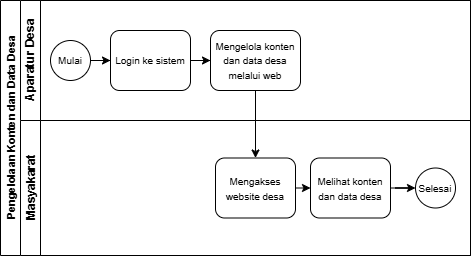

1. Admin membuat tabel di menu **Tabel Data** dengan menyusun kolom bertipe `text`, `number`, `date`, `select`, `textarea`, atau `group`. Kolom `group` dapat berisi subkolom untuk kepala tabel bertingkat. Admin juga memilih apakah tabel menampilkan nomor baris, total baris, dan total kolom, serta mengisi sumber dan catatan.
2. Admin mengisi baris data melalui halaman Input Data. Aturan validasi dibentuk otomatis dari struktur kolom.
3. Admin menambahkan grafik dari tabel tersebut dengan tipe `bar`, `line`, `area`, `pie`, `doughnut`, atau `radar`.
4. Perubahan langsung tampil di halaman Data Desa. Pengunjung dapat mengunduh tabel melalui `/data-desa/{table}/download` sebagai CSV (lengkap dengan baris total, sumber, dan catatan) atau JSON (`?format=json`).

Berita, infografis, dan publikasi dikelola dengan pola tambah, ubah, dan hapus yang sama. Gambar berita dan infografis dibatasi 2 MB, sedangkan berkas publikasi disimpan di `public/dokumen/publikasi/` dan diunduh melalui `/publikasi/{publikasi}/download`.

### 6.3 Replikasi ke desa baru

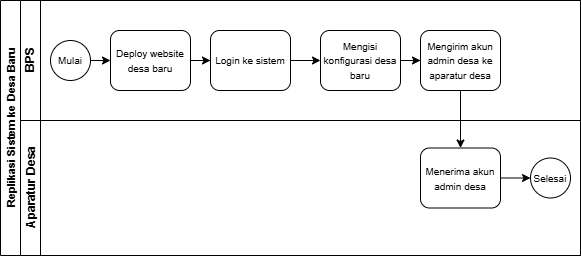

1. Admin BPS menyiapkan domain dan basis data baru untuk desa tujuan.
2. Admin BPS mengunggah kode program yang sama tanpa perubahan, lalu mengisi `.env` dengan alamat situs dan basis data baru (Bagian 10).
3. Admin BPS menjalankan migrasi dan *seeder*, lalu masuk dengan akun Admin BPS.
4. Admin BPS mengisi identitas desa (nama desa, kecamatan, kabupaten, provinsi) dan profil desa di menu **Profil Desa**.
5. Admin BPS membuat akun Admin Desa di menu **Kelola Pengguna** dan menyerahkannya kepada aparatur desa.

Karena nama desa dibaca dari tabel `settings` dan dibagikan ke semua halaman melalui `HandleInertiaRequests`, tidak ada teks nama desa yang perlu diubah di kode.

## 7. Daftar Rute

Sistem tidak memiliki REST API. Setiap rute di bawah ini mengembalikan halaman Inertia, unduhan berkas, atau pengalihan. Daftar lengkap dapat dilihat dengan `php artisan route:list`.

| Kelompok | Contoh rute | Akses |
|---|---|---|
| Halaman publik | `GET /`, `GET /profil-desa`, `GET /data-desa`, `GET /berita`, `GET /berita/{slug}`, `GET /infografis`, `GET /infografis/{infografis}`, `GET /publikasi` | Publik |
| Unduhan publik | `GET /data-desa/{table}/download`, `GET /publikasi/{publikasi}/download` | Publik |
| Autentikasi | `GET/POST /register`, `GET/POST /login`, `POST /logout`, `GET /forgot-password`, `GET /reset-password/{token}`, `GET /verify-email/{id}/{hash}` | Publik atau sudah masuk |
| Notifikasi | `GET /notifications`, `POST /notifications/{id}/mark-read`, `POST /notifications/mark-all-read` | Sudah masuk |
| Profil pengguna | `GET /akun/profil`, `PATCH /akun/profil` | Sudah masuk dan surel terverifikasi |
| Layanan | `GET /layanan/surat-pengantar-ktp` (dan 11 formulir lainnya), `POST /layanan/submit`, `POST /akun/layanan/{layanan}/rating` | Pengguna Terdaftar dengan surel terverifikasi |
| Pengaturan akun | `GET/PATCH /settings/profile`, `GET/PUT /settings/password`, `GET /settings/appearance` | Sudah masuk |
| Dasbor dan pengguna | `GET /admin/dashboard`, `resource /admin/users` | Admin |
| Konten | `resource /admin/berita`, `resource /admin/infografis`, `resource /admin/publikasi` | Admin (menu hanya untuk Admin Desa) |
| Profil desa | `GET /admin/profil-desa/edit`, `POST /admin/profil-desa` | Admin |
| Pengajuan layanan | `GET /admin/layanan`, `PUT /admin/layanan/{layanan}/update-status`, `DELETE /admin/layanan/{layanan}/result-file`, `DELETE /admin/layanan/{layanan}` | Admin (menu hanya untuk Admin Desa) |
| Jenis layanan | `GET /admin/layanan-settings`, `POST /admin/layanan-settings/toggle`, `POST /admin/layanan-settings/toggle-bulk` | Admin (menu hanya untuk Admin BPS) |
| Tabel data | `resource /admin/dynamic-tables`, `GET/POST /admin/dynamic-tables/{id}/insert`, `PUT/DELETE /admin/dynamic-tables/{id}/data/{data}`, `GET/POST /admin/dynamic-tables/{id}/charts` | Admin |
| Pemeriksaan server | `GET /up` | Publik |

## 8. Keamanan

- **Autentikasi.** Kata sandi disimpan sebagai *hash* bcrypt melalui *cast* `hashed` pada model `User`. Sesi memakai *cookie* Laravel, dan setiap formulir dilindungi token CSRF yang disisipkan otomatis oleh Inertia.
- **Verifikasi surel.** Model `User` mengimplementasikan `MustVerifyEmail`. Tautan verifikasi bertanda tangan (*signed URL*) dan dibatasi 6 permintaan per menit.
- **Pembatasan percobaan.** Masuk dibatasi oleh `LoginRequest` bawaan Laravel, dan pembaruan kata sandi dibatasi dengan *throttle*.
- **Otorisasi.** Pembatasan utama ditegakkan oleh middleware dan *controller* seperti pada Bagian 2. Pengguna hanya dapat menilai pengajuannya sendiri.
- **Validasi unggahan.** Setiap unggahan dibatasi jenis berkas (`mimes`) dan ukurannya. Nama berkas diganti dengan nama unik sebelum disimpan.
- **Rahasia konfigurasi.** Nilai rahasia seperti `APP_KEY`, kata sandi basis data, dan kata sandi SMTP disimpan di `.env`, yang tercantum di `.gitignore`. Repositori hanya memuat `.env.example`.

Hal yang perlu diperhatikan pada pengembangan berikutnya:

- Rute konten, pengajuan layanan, dan pengaturan jenis layanan hanya dilindungi `admin.only`, sehingga pemisahan antara Admin Desa dan Admin BPS pada menu tersebut baru ditegakkan di tampilan. Bila pemisahan harus mutlak, tambahkan pemeriksaan peran di *controller* atau middleware terpisah.
- Lampiran pengajuan dan dokumen hasil disimpan di bawah `public/`, sehingga dapat dibuka oleh siapa pun yang mengetahui alamatnya. Untuk data pribadi warga, sebaiknya berkas dipindah ke `storage/app` dan diunduh melalui *controller* yang memeriksa kepemilikan.
- `routes/web.php` masih memuat rute `/profile` yang merujuk `App\Http\Controllers\ProfileController`, padahal kelas tersebut tidak ada. Nama rutenya juga sama dengan rute di `routes/settings.php`, yang dimuat belakangan sehingga menimpanya. Rute ini aman dihapus.
- *Seeder* membuat akun admin dengan kata sandi awal yang tertulis di `DatabaseSeeder.php`. Ganti kata sandi tersebut segera setelah instalasi pada setiap instans.

## 9. Pengujian

| Jenis | Cakupan | Hasil |
|---|---|---|
| Black Box Testing | 41 skenario yang mencakup seluruh fungsi pada use case (Tabel 4 pada buku skripsi) | 41 berhasil |
| System Usability Scale | 10 responden, yaitu 3 pegawai BPS, 3 aparatur desa, dan 4 warga | Rata-rata 80,5 (kategori *Excellent*) |
| Portability Testing (ISO/IEC 25010) | Replikasi ke Desa Galung dan Desa Tea Malala, dinilai dari aspek *installability*, *adaptability*, dan konsistensi fungsional | Seluruh aspek berhasil pada kedua desa |

## 10. Instalasi dan Penerapan

Prasyarat: PHP 8.2 atau lebih baru dengan ekstensi `zip`, `pdo_mysql`, `mbstring`, dan `fileinfo`, Composer, Node.js 20 atau lebih baru dengan npm, serta MySQL atau MariaDB. Pada Windows, XAMPP sudah cukup, asalkan `extension=zip` diaktifkan di `php.ini`.

```bash
git clone https://github.com/LRin15/desa_cinnong.git
cd desa_cinnong

composer install
npm install

cp .env.example .env
php artisan key:generate

# Isi pengaturan basis data di .env, lalu:
php artisan migrate --seed      # atau impor desa_db.sql untuk memakai data contoh

# Pengembangan (server Laravel, antrean, dan Vite sekaligus)
composer dev

# Produksi
npm run build
```

Variabel lingkungan yang perlu disesuaikan pada setiap instans:

| Variabel | Keterangan |
|---|---|
| `APP_NAME`, `APP_URL` | Nama aplikasi dan alamat situs desa, misalnya `https://galung.bone.stat7300.net` |
| `APP_ENV`, `APP_DEBUG` | `production` dan `false` pada server |
| `DB_CONNECTION`, `DB_HOST`, `DB_PORT`, `DB_DATABASE`, `DB_USERNAME`, `DB_PASSWORD` | Basis data instans. `.env.example` bawaan masih berisi `sqlite`, sehingga ubah ke `mysql` |
| `MAIL_MAILER`, `MAIL_HOST`, `MAIL_PORT`, `MAIL_USERNAME`, `MAIL_PASSWORD`, `MAIL_ENCRYPTION`, `MAIL_FROM_ADDRESS`, `MAIL_FROM_NAME` | Pengiriman surel verifikasi, atur ulang kata sandi, dan notifikasi layanan. Untuk pengembangan, `MAIL_MAILER=log` menulis surel ke `storage/logs` |
| `RESEND_KEY` | Hanya bila `MAIL_MAILER=resend` |

Pada hosting bersama, arahkan *document root* domain ke folder `public/`, unggah hasil `npm run build` (folder `public/build/`), dan pastikan folder `storage/`, `bootstrap/cache/`, `public/images/`, dan `public/dokumen/` dapat ditulis oleh server web. Setelah instalasi, lanjutkan dengan langkah replikasi pada Bagian 6.3.

Perintah lain yang tersedia:

| Perintah | Fungsi |
|---|---|
| `npm run dev` | Menjalankan Vite saja |
| `npm run build:ssr`, `composer dev:ssr` | *Build* dan menjalankan mode *server-side rendering* |
| `npm run lint`, `npm run format`, `npm run types` | ESLint, Prettier, dan pemeriksaan tipe TypeScript |
| `./vendor/bin/pint` | Merapikan gaya kode PHP |

## 11. Tampilan Antarmuka

Tangkapan layar berikut sama dengan Gambar 61–95 pada buku skripsi.

| Gambar | Tampilan |
|---|---|
| 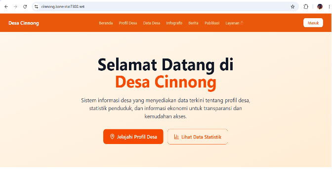 | Beranda |
| 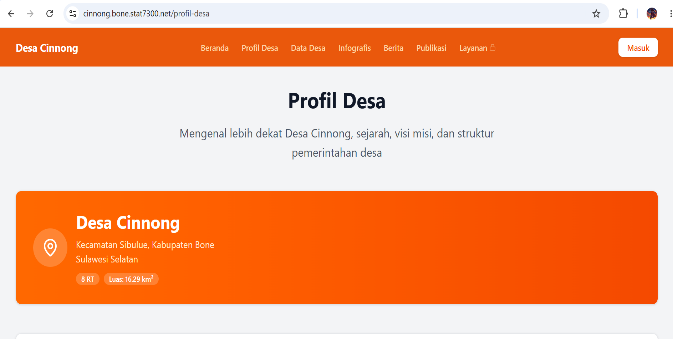 | Profil Desa |
| 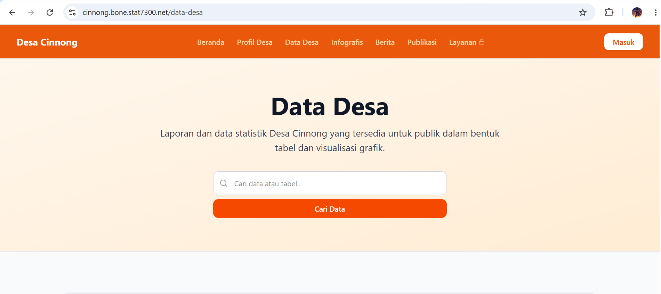 | Data Desa beserta tabel dan grafik |
| 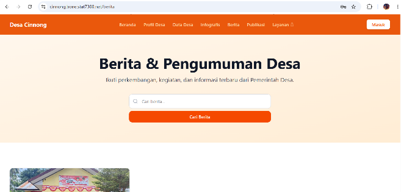 | Berita |
| 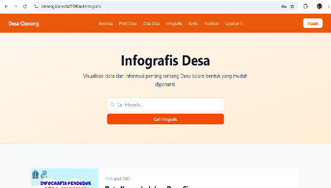 | Infografis |
| 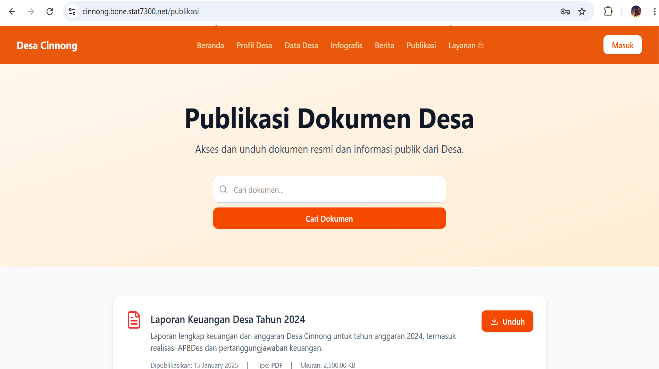 | Publikasi |
| 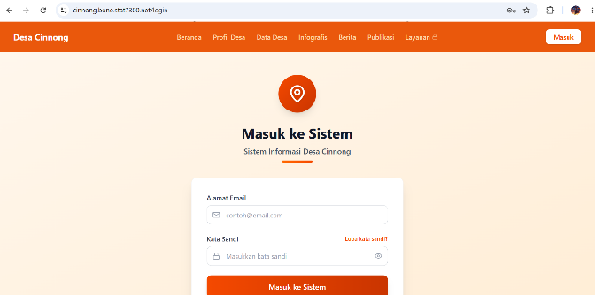 | Masuk |
| 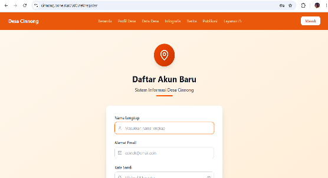 | Registrasi |
| 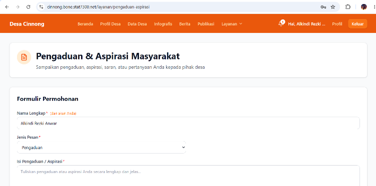 | Formulir pengajuan layanan |
| 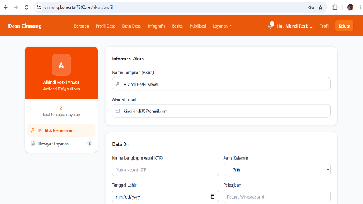 | Profil pengguna terdaftar |
| 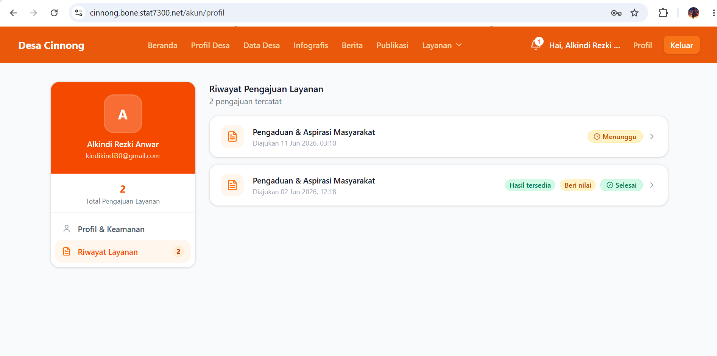 | Riwayat pengajuan |
| 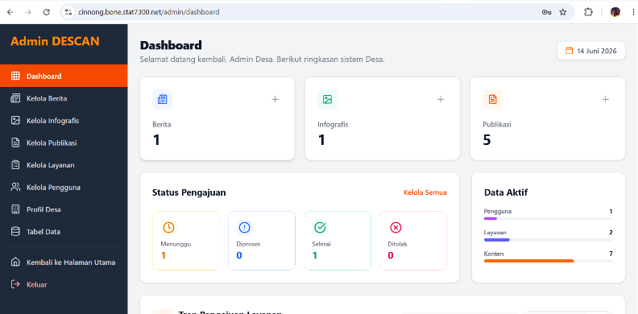 | Dasbor admin |
| 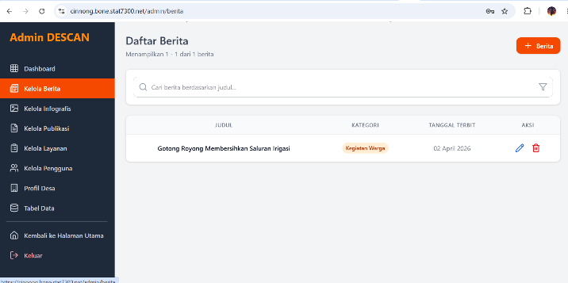 | Kelola Berita |
| 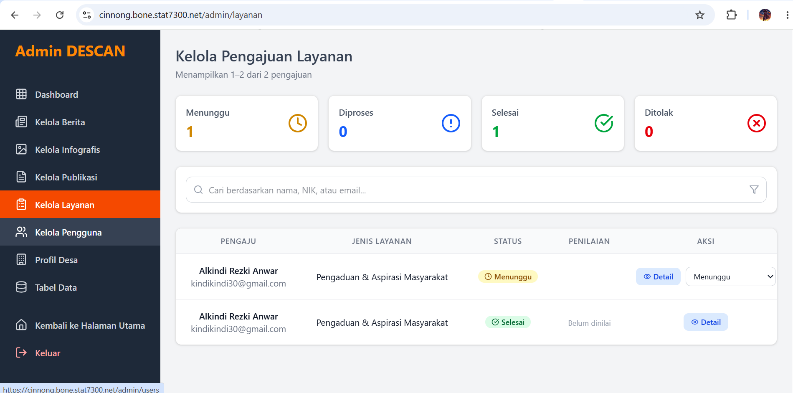 | Kelola Pengajuan Layanan |
| 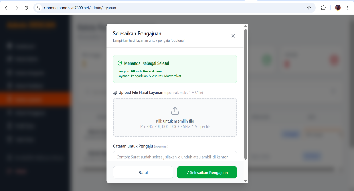 | Menyelesaikan pengajuan dan mengunggah dokumen hasil |
| 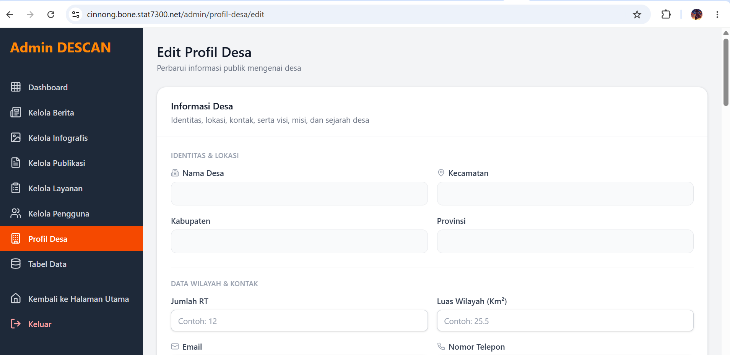 | Kelola Profil Desa |
| 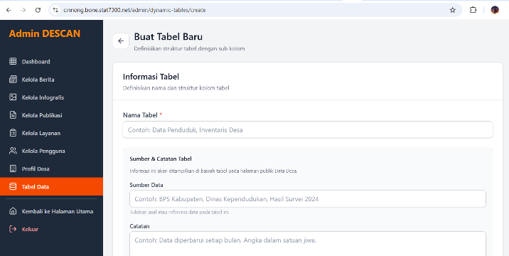 | Menyusun struktur tabel data |
| 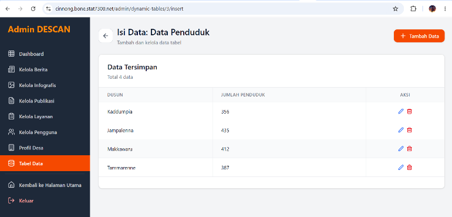 | Input data tabel |
| 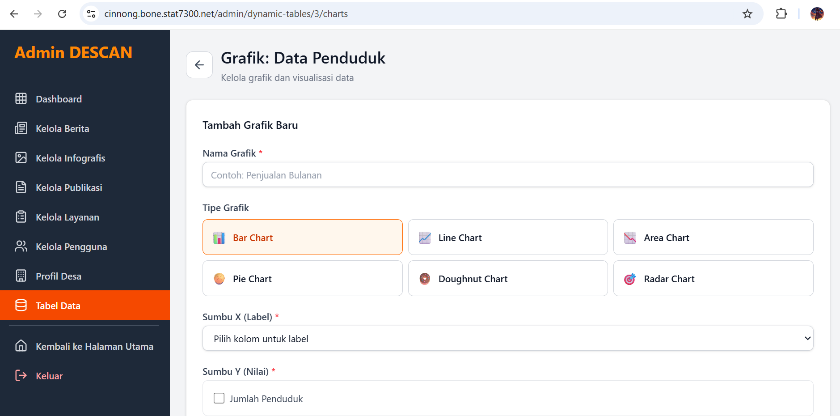 | Menambah grafik |
| 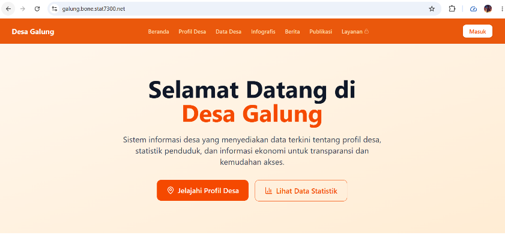 | Hasil replikasi di Desa Galung |
| 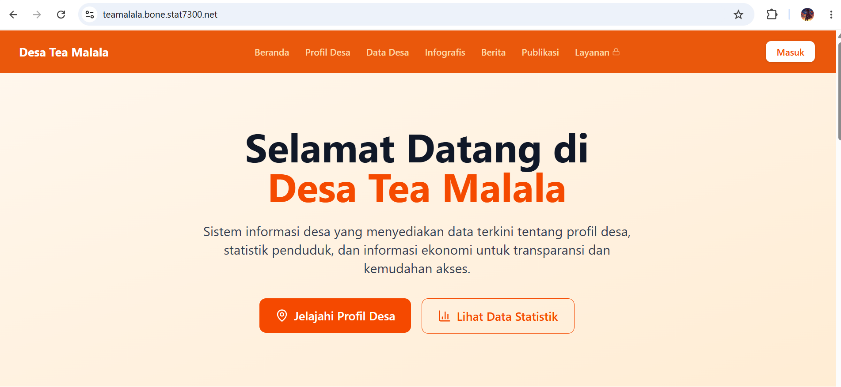 | Hasil replikasi di Desa Tea Malala |

Seluruh tangkapan layar lainnya ada di folder [`gambar/`](gambar/).
